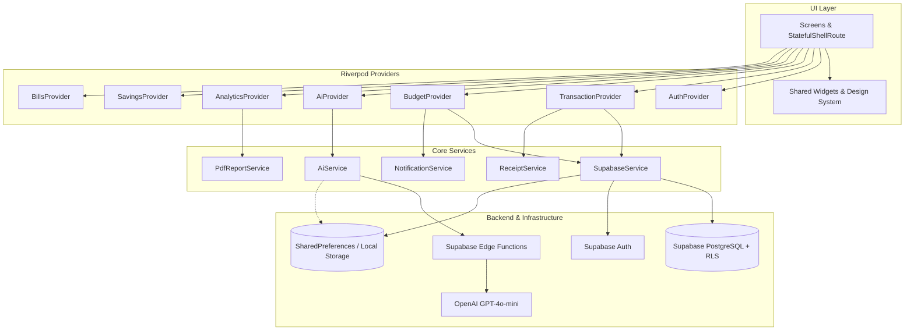

<div align="center">

# 💎 NEXORA

### *Your Money. Your Intelligence.*

An AI-powered, luxury-grade personal finance and wealth management mobile application built with **Flutter**, **Riverpod**, and **GoRouter**, powered by a **Supabase** backend and **OpenAI** Edge Intelligence.

[](https://flutter.dev)
[](https://dart.dev)
[](https://riverpod.dev)
[](https://pub.dev/packages/go_router)
[](https://supabase.com)
[](https://openai.com)
[](#-supported-platforms)
[](https://opensource.org/licenses/MIT)
[](CONTRIBUTING.md)

[Features](#-key-features) • [Architecture](#-system-architecture) • [Tech Stack](#-technology-stack) • [Quickstart](#-quickstart--installation) • [Database Setup](#-backend--database-setup) • [Folder Structure](#-project-structure) • [Contributing](#-contributing)

---

</div>

## 📖 Overview

**NEXORA** transforms personal expense tracking into an intuitive, intelligence-driven financial copilot. Built using modern Flutter architecture patterns and styled with a luxury dark fintech aesthetic (inspired by modern digital banking leaders), NEXORA helps individuals take full control of their cash flow, observe category spending caps, automate savings milestones, and receive instant, personalized financial advice grounded in their actual real-time spending data.

Whether running offline in **Zero-Config Dev / Demo Mode** or connected to an enterprise **Supabase** backend with **OpenAI Edge Functions**, NEXORA delivers a seamless, high-performance financial management experience.

---

## ✨ Key Features

### 1. 📊 Luxury Fintech Dashboard
* **Dynamic Net Balance**: Real-time cash balance with an interactive privacy eye toggle to mask numbers in public spaces.
* **Cash Flow Velocity**: Visual indicators for total monthly inflows vs. outflows.
* **Weekly Spending Bar Chart**: Day-by-day cash velocity powered by `fl_chart`.
* **AI Financial Spotlight**: Contextual banner highlighting your most urgent spending anomaly or budget threshold breach.
* **Quick Action Controls**: Instant modal access to Add Expense, Add Income, Transfer, and Analytics.
* **Recent Activity Ledger**: Real-time transaction list with category icons and direct drill-down.

### 2. 💳 Full Transaction Suite & Receipt Capture
* **Comprehensive CRUD**: Add, view, filter, edit, and delete transactions.
* **11 Predefined Fintech Categories**: Food & Dining, Shopping, Transportation, Entertainment, Healthcare, Education, Bills, Travel, Salary, Investments, and Other.
* **Flexible Payment Methods**: Debit Card, Credit Card, Bank Transfer, Cash, UPI, and Cryptocurrency.
* **Receipt Proof**: Attach camera photos or gallery images directly to transactions via `image_picker`.
* **Search & Multi-Filter**: Search by title or notes, and filter by transaction type (*Income*, *Expense*, *Transfer*) and category.

### 3. 🎯 Smart Category Budgeting & Threshold Alerts
* **Granular Spending Limits**: Define custom monthly spending caps for individual categories.
* **Dynamic Visual Thresholds**: Color-coded progress bars transition automatically:
  * 🟢 **Mint Green** (< 80% consumed)
  * 🟡 **Amber Warning** (80% – 99% consumed)
  * 🔴 **Coral Red** (100%+ limit exceeded)
* **Local Push Notifications**: Automated local push notifications triggered via `flutter_local_notifications` when nearing or surpassing limits.

### 4. 🤖 Context-Aware AI Financial Assistant
* **Dual-Engine Architecture**:
  * **Cloud Mode**: Supabase Edge Function (`ai-advisor`) interacting securely with OpenAI GPT-4o-mini without exposing API keys on the client.
  * **Local Offline Engine**: Rule-based contextual fallback intelligence that analyzes monthly income, expenses, savings rate, and category velocity offline.
* **Live Financial Prompts**:
  * *"Where am I spending the most money?"*
  * *"How can I save more?"*
  * *"What are my biggest expenses this month?"*
  * *"Am I overspending?"*
  * *"How much can I save this month?"*
* **Compliance & Safety**: Built-in regulatory disclaimers clarifying suggestions as non-advisory educational insights.

### 5. 💡 AI Insights & Anomaly Detection Feed
* **Unusual Spending Spikes**: Identifies abnormal expense spikes within specific categories.
* **Month-Over-Month Comparison**: Calculates percentage shifts against prior billing cycles (e.g., *"You spent 18% more on Food & Dining this month"*).
* **Automated Savings Recommendations**: Suggests micro-allocations into high-priority savings targets based on surplus cash flow.

### 6. 🏆 Savings Goals & Milestones
* **Target Management**: Set custom milestone targets with target completion dates, icons, and accent colors.
* **Incremental Contributions**: Deposit funds towards specific goals with tracked progress history.
* **Achievement Dialogs**: Celebratory feedback modal triggered upon reaching 100% funding.

### 7. 📑 Advanced Analytics & PDF Financial Statements
* **Custom Time Horizons**: Switch between Weekly, Monthly, and Yearly analytics.
* **Category Donut / Pie Breakdown**: Interactive expenditure proportion charts (`fl_chart`).
* **Multi-Page PDF Statements**: Generates branded, publication-ready financial statements using `pdf` and `printing` with summary cards, category distributions, and itemized transaction tables. Print or share directly via native OS share sheets.

### 8. ⏰ Recurring Bills & Subscription Reminders
* **Subscription & Utility Tracking**: Monitor recurring obligations such as Internet, Rent, Subscriptions, and Utilities.
* **Due Date Countdown**: Highlights upcoming due dates, due-today notices, and overdue flags.
* **Scheduled Local Alerts**: Receive advance reminders before bill due dates.

### 9. ⚙️ Profile, Currency & Security Preferences
* **Multi-Currency Support**: Switch seamlessly between 8 international currencies:
  * USD (`$`), EUR (`€`), GBP (`£`), INR (`₹`), JPY (`¥`), CAD (`CA$`), AUD (`AU$`), SGD (`SG$`)
* **Dark Mode Luxury Theme**: High-contrast, OLED-friendly color palette (Deep Navy `#10172A`, Electric Purple `#7257E8`, Mint `#35C99A`).
* **Biometric Authentication**: FaceID / TouchID biometric toggle.
* **Dynamic Cloud Configuration**: Switch between **Demo Mode** (zero backend setup required) or connect your live Supabase instance with a single tap in **Profile > Cloud Connection**.

---

## 🏛️ System Architecture

NEXORA adheres to **Feature-First Clean Architecture** with unidirectional data flow powered by **Riverpod**:



---

## 🛠️ Technology Stack

| Domain | Technology / Library | Version | Description |
|---|---|---|---|
| **Framework** | [Flutter](https://flutter.dev) | `^3.41.0` | Cross-platform UI toolkit |
| **Language** | [Dart](https://dart.dev) | `^3.11.4` | Sound null-safe client language |
| **State Management** | [Flutter Riverpod](https://riverpod.dev) | `^2.6.1` | Reactive, compile-safe state management |
| **Routing** | [GoRouter](https://pub.dev/packages/go_router) | `^17.5.0` | Declarative routing with `StatefulShellRoute` |
| **Backend & Auth** | [supabase_flutter](https://pub.dev/packages/supabase_flutter) | `^2.18.3` | PostgreSQL, Auth, and Storage client |
| **Charts** | [fl_chart](https://pub.dev/packages/fl_chart) | `^1.3.0` | High-performance interactive charts |
| **PDF Generation** | [pdf](https://pub.dev/packages/pdf) & [printing](https://pub.dev/packages/printing) | `^3.12.0` / `^5.14.3` | Document construction & native OS print sheet |
| **Notifications** | [flutter_local_notifications](https://pub.dev/packages/flutter_local_notifications) | `^22.3.3` | Scheduled local notifications |
| **Camera & Gallery** | [image_picker](https://pub.dev/packages/image_picker) | `^1.2.4` | Native device media picker |
| **Typography** | [google_fonts](https://pub.dev/packages/google_fonts) | `^8.2.1` | Typography using *Plus Jakarta Sans* |
| **Formatting** | [intl](https://pub.dev/packages/intl) | `^0.20.3` | Date, time, and currency internationalization |
| **Edge Compute** | Supabase Edge Functions | Deno 1.28+ | Serverless proxy for OpenAI GPT-4o-mini |

---

## 📁 Project Structure

```text
nexora/
├── lib/
│   ├── app.dart                             # Application entry & MaterialApp configuration
│   ├── main.dart                            # main() entrypoint, Service initialization
│   ├── core/
│   │   ├── constants/
│   │   │   ├── app_colors.dart              # Fintech luxury dark & light palettes
│   │   │   └── app_constants.dart           # Categories, currencies, payment methods
│   │   ├── routing/
│   │   │   └── app_router.dart              # GoRouter configuration & StatefulShellRoute
│   │   ├── services/
│   │   │   ├── ai_service.dart              # Cloud edge + offline local AI reasoning
│   │   │   ├── notification_service.dart    # Local push notification manager
│   │   │   ├── pdf_report_service.dart      # Branded PDF statement generation
│   │   │   ├── receipt_service.dart         # Camera / Gallery image attachments
│   │   │   └── supabase_service.dart        # Supabase client wrapper & demo fallback
│   │   ├── theme/
│   │   │   └── app_theme.dart               # Material 3 light & dark theme definitions
│   │   └── utils/
│   │       ├── currency_formatter.dart      # Currency conversions & symbols
│   │       ├── date_formatter.dart          # Localized date representations
│   │       └── validators.dart              # Form validation utilities
│   ├── features/
│   │   ├── ai_assistant/                    # Chatbot interface & AI insights feed
│   │   ├── analytics/                       # Donut/bar charts & PDF report export
│   │   ├── auth/                            # Login, Register, Forgot Password
│   │   ├── bills/                           # Recurring bills & subscription manager
│   │   ├── budgets/                         # Spending caps & progress thresholds
│   │   ├── dashboard/                       # Executive home dashboard & cash flow
│   │   ├── onboarding/                      # Animated splash screen & 3-step onboarding
│   │   ├── profile/                         # Preferences, currency, biometric, cloud sync
│   │   ├── savings/                         # Savings milestones & goal contributions
│   │   └── transactions/                    # Transaction ledger, forms & receipt detail
│   └── shared/
│       ├── models/                          # Cross-feature models (FinancialSummary)
│       ├── providers/                       # Global theme & settings providers
│       └── widgets/                         # Reusable UI widgets (cards, buttons, icons)
├── supabase/
│   ├── migrations/
│   │   └── 20261105000000_nexora_schema.sql # PostgreSQL schema & RLS policies
│   └── functions/
│       └── ai-advisor/
│           └── index.ts                     # Secure Deno OpenAI Edge Function
├── test/
│   └── widget_test.dart                     # Unit & widget integration tests
└── pubspec.yaml                             # Package dependencies & assets
```

---

## 🚀 Quickstart & Installation

### Prerequisites
* [Flutter SDK](https://docs.flutter.dev/get-started/install) (`v3.41.0` or higher)
* [Dart SDK](https://dart.dev/get-dart) (`v3.11.4` or higher)
* Xcode (for iOS / macOS builds)
* Android Studio / Android SDK (for Android builds)
* Git

### 1. Clone the Repository
```bash
git clone git@github.com:trydigital2/nexora.git
cd nexora
```

### 2. Install Dependencies
```bash
flutter pub get
```

### 3. Run Static Analysis & Tests
```bash
# Verify code quality
flutter analyze

# Execute test suite
flutter test
```

### 4. Launch the Application

NEXORA includes an immediate **Zero-Config Demo Mode** enabled by default, allowing you to run and explore every screen without setting up a backend first:

```bash
# Run on connected device or simulator
flutter run

# Run on specific target
flutter run -d ios
flutter run -d android
flutter run -d macos
```

---

## 🗄️ Backend & Database Setup

If you wish to connect your own Supabase project:

### 1. Create a Supabase Project
Sign up or log in at [supabase.com](https://supabase.com) and create a new project.

### 2. Apply Database Schema Migrations
Navigate to the **SQL Editor** in your Supabase dashboard and run the SQL migration script:
[`supabase/migrations/20261105000000_nexora_schema.sql`](supabase/migrations/20261105000000_nexora_schema.sql)

This script sets up:
* `profiles` (User profile, currency, monthly income, biometric flags)
* `transactions` (Incomes, expenses, transfers with categories and receipt links)
* `budgets` (Category budget allocations and thresholds)
* `savings_goals` & `savings_contributions` (Milestones and deposit history)
* `recurring_bills` (Subscriptions, utility schedules, and due reminders)
* `notifications` (Push and local notification event history)
* `ai_insights` (Anomaly detection logs and category variance)
* `chat_history` (Conversational memory for AI assistant)
* **Row Level Security (RLS)** policies ensuring users can only read and write their own data.

### 3. Deploy the AI Advisor Edge Function
Deploy the secure OpenAI proxy edge function using the Supabase CLI:

```bash
# Log in to Supabase CLI
supabase login

# Link your project
supabase link --project-ref your-project-ref

# Set your OpenAI API key secret
supabase secrets set OPENAI_API_KEY="sk-your-openai-api-key"

# Deploy edge function
supabase functions deploy ai-advisor --no-verify-jwt
```

### 4. Connect NEXORA to your Supabase Project

You have two easy options to configure credentials:

#### Option A: In-App UI Configuration (No rebuild required)
1. Launch the app and go to **Profile > Cloud Connection**.
2. Enter your **Supabase URL** and **Anon Key**.
3. Toggle off **Demo Mode** and tap **Save & Connect**.

#### Option B: Compile-Time Environment Flags
Pass your credentials during build time:
```bash
flutter run \
  --dart-define=SUPABASE_URL="https://your-project.supabase.co" \
  --dart-define=SUPABASE_ANON_KEY="your-supabase-anon-key"
```

---

## 📱 Supported Platforms

| Platform | Support Status | Notes |
|---|---|---|
| **iOS** | Supported | iOS 14.0+ (Tested on iPhone & iPad) |
| **Android** | Supported | Android 6.0+ (API level 23+) |
| **macOS** | Supported | macOS 12.0+ Desktop builds |

---

## 🔒 Security & Privacy

* **Zero Plaintext Secrets**: OpenAI API keys are kept entirely on Supabase Edge Functions and are never exposed in the client binary.
* **Row Level Security (RLS)**: Every database table strictly enforces PostgreSQL RLS policies tied to the authenticated user's UUID.
* **Privacy Balance Cloaking**: A single tap on the balance eye toggle hides sensitive financial numbers from view.
* **Biometric Authentication**: Native FaceID / TouchID biometric protection.
* **Financial Disclaimer**: Built-in regulatory disclaimers clarify that conversational AI responses are educational simulations and do not constitute certified financial or investment advice.

---

## 🤝 Contributing

Contributions, bug reports, and feature requests are welcome!

1. **Fork the Repository** (`git clone git@github.com:trydigital2/nexora.git`)
2. **Create your Feature Branch**:
   ```bash
   git checkout -b feature/amazing-feature
   ```
3. **Commit your Changes**:
   ```bash
   git commit -m "feat: add predictive cashflow chart"
   ```
4. **Push to the Branch**:
   ```bash
   git push origin feature/amazing-feature
   ```
5. **Open a Pull Request** against `main`.

Please ensure all tests pass (`flutter test`) and `flutter analyze` reports zero warnings prior to submitting PRs.

---

## 📄 License

This project is licensed under the **MIT License** — see the [LICENSE](LICENSE) file for details.

---

<div align="center">

Made with ❤️ by [TryDigital](https://github.com/trydigital2)

*Empowering smarter financial decisions through elegant engineering.*

</div>
